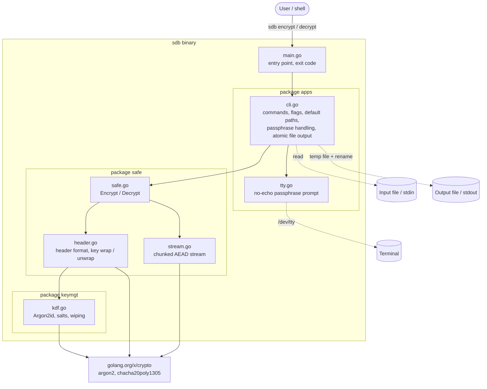
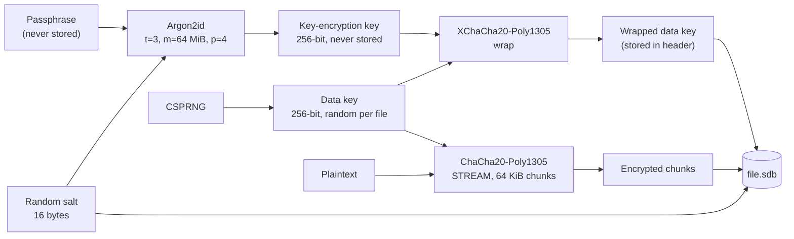
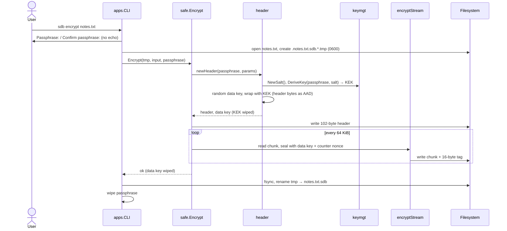
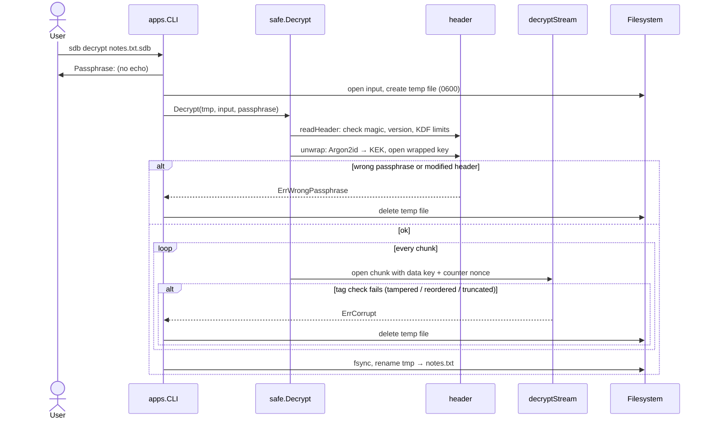

# Architecture

Safe Deposit Box (`sdb`) is a small, single-binary Go CLI that encrypts and decrypts
files or streams with a passphrase. This page describes how it is organised and how
data flows through it.

## Components



| Package | Responsibility | Knows about files/terminals? |
|---------|----------------|------------------------------|
| `main` | Calls `apps.NewCLI().Run(args)` and exits with its status code | no |
| `apps` | User interface: sub-commands, flags, output naming, prompting, atomic writes | **yes** |
| `safe` | The SDB file format: header, key wrapping, chunked encryption | no, works on `io.Reader`/`io.Writer` only |
| `keymgt` | Passphrase → key derivation (Argon2id), salts, memory wiping | no |

The cryptographic core (`safe`, `keymgt`) has no knowledge of files, flags or terminals.
That keeps it easy to test in memory and easy to reuse later (e.g. from a GUI or server).

## Envelope encryption
SDB works like a bank's safe deposit box. Your passphrase opens the box, and inside the
box is the key that locks your data. The data itself is never locked with the passphrase.



Why two keys?

- **Strength:** the data key is fully random, so data encryption is full-strength
  whatever the passphrase quality. Argon2id only has to protect a 32-byte key.
- **Efficiency:** the expensive Argon2id step runs once per file. Bulk encryption uses
  ChaCha20-Poly1305 at around 2 GB/s per core.
- **Room to grow:** changing a passphrase, or adding another way to unlock (e.g. a key
  file or public key), only means re-wrapping the 32-byte data key.

## Encryption flow



## Decryption flow



## File format (v1)

```
┌──────────────────────── header: 102 bytes ────────────────────────┐┌──────── payload ────────┐
│"SDB"│ver│kdf│ time │ memory │thr│  salt  │ wrap nonce │ wrapped key ││ chunk 0 │ chunk 1 │ … │
│  3  │ 1 │ 1 │  4   │   4    │ 1 │   16   │     24     │   32 + 16   ││ ≤64KiB+16 each          │
└────────────── authenticated as associated data (54 bytes) ─────────┘└─────────────────────────┘
```

- **Header:** everything before the wrapped key is used as associated data when the key
  is wrapped, so changing any header byte makes unwrapping fail.
- **Chunks:** each chunk is sealed with ChaCha20-Poly1305 under the data key. The 12-byte
  nonce is an 11-byte chunk counter plus a 1-byte *final* flag. As a result:
  - **reordering** chunks fails (wrong counter);
  - **truncating** the file fails (the new last chunk was not sealed as final);
  - **appending** data fails (data after the final chunk cannot authenticate);
  - **modifying** any byte fails (Poly1305 tag).
- Since every file has a fresh random data key, counter nonces can never repeat under
  the same key.

## Security properties

| Property | How it is achieved |
|----------|--------------------|
| Confidentiality | ChaCha20 with a 256-bit random data key |
| Integrity and authenticity | Poly1305 tag on every chunk and on the wrapped key |
| Passphrase guessing resistance | Argon2id, memory-hard, salted per file |
| Key never stored | only the wrapped data key is written; passphrase and KEK live in memory only |
| Short key lifetime in memory | keys and passphrases are zeroed after use (best effort in Go) |
| No partial plaintext on failure | file output is written to a 0600 temp file and renamed only after full verification |
| DoS-resistant parsing | Argon2id parameters from headers are range-checked before use |
| Constant memory | streaming with a single reused 64 KiB buffer, about 70 MB peak with Argon2id included |

### Limitations
- When decrypting **to stdout**, verified chunks are streamed before the end of the file
  has been checked. If decryption fails partway, discard what was already written. File
  output does not have this problem.
- Go's garbage collector may copy memory, so wiping keys is best effort.
- The original file is left in place after encryption. Securely erasing it is the user's
  responsibility.
- Strength is ultimately bounded by the passphrase. See [argon2id.md](argon2id.md).

## Algorithm choices

| Purpose | Algorithm | Why |
|---------|-----------|-----|
| Passphrase → key | Argon2id | RFC 9106 recommendation and PHC winner; memory-hard |
| Data encryption | ChaCha20-Poly1305 | 256-bit AEAD, constant-time in software, ~2 GB/s per core on this CPU, used by TLS 1.3, WireGuard and age |
| Key wrapping | XChaCha20-Poly1305 | 192-bit nonce, so a random nonce is safe |
| Chunking | STREAM (Hoang, Reyhanitabar, Rogaway, Vizár 2015) | provably secure online authenticated encryption |

AES-256-GCM would be equally secure and is faster on CPUs with AES hardware instructions.
ChaCha20 was chosen because it stays fast and resistant to timing side channels on
**every** CPU, without depending on hardware support.
